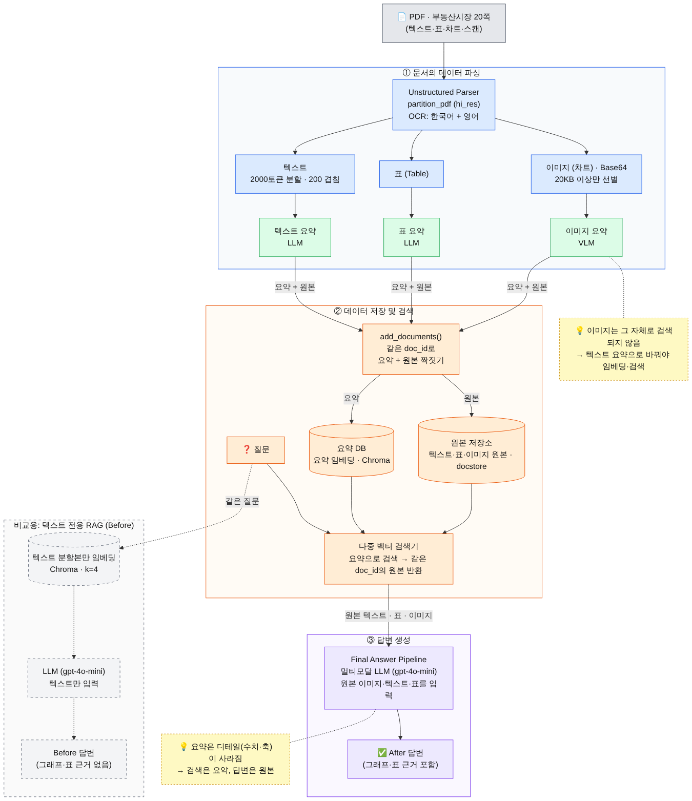
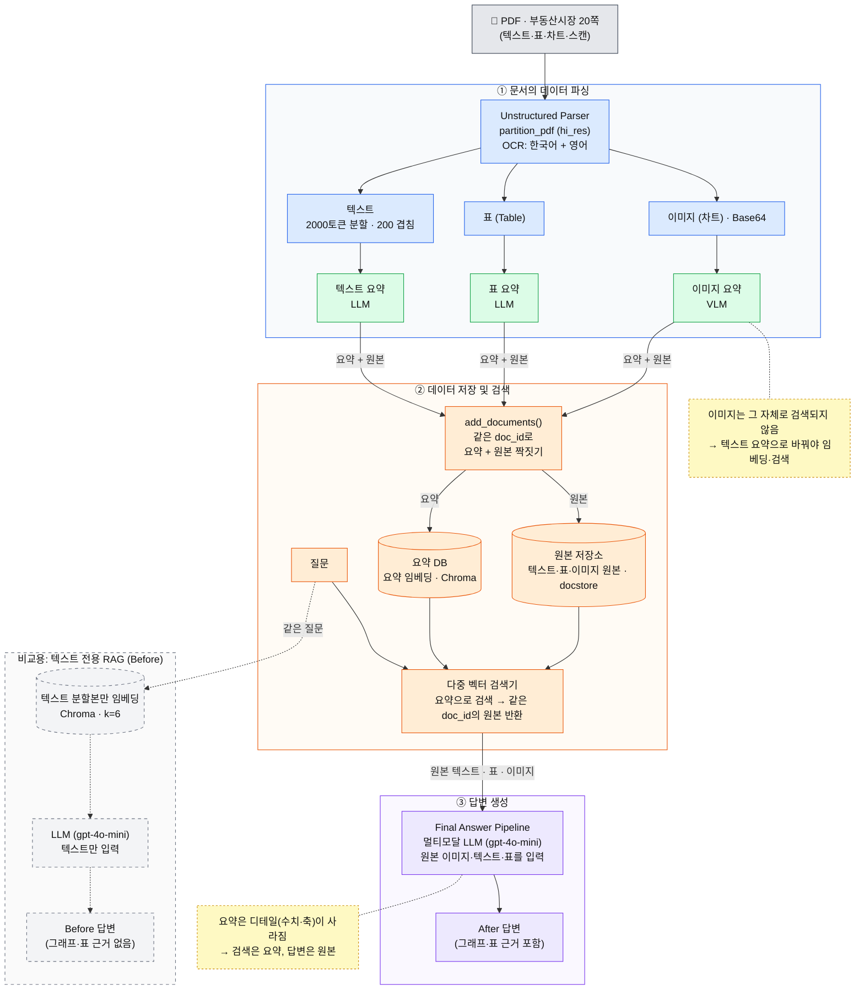
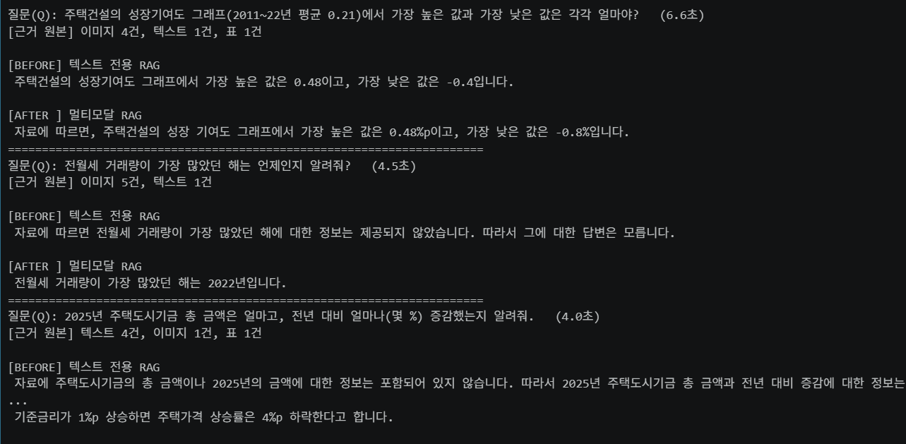

# 멀티모달 RAG 과제
## 주제: 부동산시장 PDF에서 표, 차트까지 확인해서 질의응답

PDF 한 편에서 **텍스트·표·그래프(이미지)** 를 분리해 추출하고, 각각을 **요약**해 검색에 쓰고, 답변은 **원본**으로 생성하는 멀티모달 RAG입니다.
같은 질문을 **텍스트 전용 RAG(Before)** 와 **멀티모달 RAG(After)** 에 던져 차이를 확인했습니다.

> 실행 노트북: [`multimodal_rag_ip.ipynb`](./multimodal_rag_ip.ipynb)

---

## 1. 문제 정의

### 이 PDF의 특성
- `B_부동산시장_01_20p_텍스트+표+차트+차트(스캔)+이미지.pdf` (20쪽, 공개 자료)
- 쪽마다 **본문 일부 + 그래프 1개**로 구성된 부동산·주택시장 보고서 발췌 모음입니다. 출처: [AI Hub](https://www.aihub.or.kr/)
- 구성: 텍스트 / **표 3개**(가계대출 추이, 주거정책 법정계획, 주택 부문 예산·기금) / 막대·꺾은선 **그래프 다수** / **스캔된 쪽**(OCR 필요)
- 숫자가 **그래프와 표에만** 있는 경우가 많습니다. 예) 12쪽 주택건설 성장기여도의 연도별 막대 값, 20쪽 전월세 거래량 막대, 19쪽 주택도시기금 예산표

### 해결하려는 문제
텍스트만 읽는 일반 RAG는 그래프와 표를 버립니다. 그래서 *"전월세 거래량이 가장 많았던 해는?"*, *"2025년 주택도시기금 총액과 증감률은?"* 처럼 **그림·표에만 답이 있는 질문**에 "자료에 없다"고 답하거나 본문의 비슷한 숫자를 지어냅니다.
이 프로젝트는 그래프와 표를 검색·답변에 포함시켜, **같은 질문에서 두 방식의 답이 어떻게 다른지**를 증거(출력 캡처)로 보여 주는 것이 목표입니다.

---

## 2. 아키텍처



<details>
<summary>Mermaid 원본 (GitHub 에서 렌더링됨)</summary>



</details>

**범례** 🔵 파싱 · 🟢 요약 · 🟠 저장·검색 · 🟣 답변 생성 · 🟡 점선 노트 = 설계 이유 · ⚪ 회색 점선 = 비교용 텍스트 RAG

### 3단계 설명
1. **문서의 데이터 파싱** — partition_pdf가 PDF를 텍스트, 표, 이미지로 나누고, 텍스트는 2000토큰으로 잘라 각각 LLM/VLM(비전 모델)으로 요약한다.
2. **데이터 저장 및 검색** — 요약은 Chroma(백터DB)에, 원본은 docstore에 같은 doc_id로 저장하게 한다. 질문이 오면 요약으로 찾는다.
3. **답변 생성** — 찾은 원본(이미지,표,텍스트)를 멀티모달 LLM에 그대로 넣어 답한다. (요약만 넣으면 세부 수치가 사라지기 때문!)

---

## 3. 기술 선택 근거

| 선택 | 근거 |
| --- | --- |
| 모델 `gpt-4o-mini` | 텍스트·표·이미지 요약과 답변을 한 모델로 처리할 수 있고 저렴하다. 텍스트·표 요약 31초 + 이미지 26장 요약 121초, 텍스트 토큰 14,928로 20쪽 한 편이 2분 반 안에 끝났다. 다만 13쪽 차트를 선 그래프가 아닌 '면적 차트'로 읽고 수치도 부정확하게 적는 등 일부 차트 오독이 있었다. |
| 청크 2000토큰 / 겹침 200 | 텍스트 17,974자가 14블록으로 나뉘었다. OCR 띄어쓰기로 토큰이 늘어 블록당 약 1,300자 분량이다. 겹침은 문장이 경계에서 잘리는 것을 막는다. |
| 프롬프트 언어 | 텍스트·표 요약은 한국어, 이미지 요약은 영어 지시문 + 한국어 출력. 비교 실험은 하지 못했다. |
| `languages=["kor","eng"]` | 기본(영어)일 때 표 원본이 `Bers| 74H e) etl …`처럼 깨졌고, 적용 후 한글로 읽혔다. 표 요약도 "요약하기 어렵습니다"에서 계획·부서·연도 정리로 개선됐다. |
| `extract_image_block_types=["Image","Table"]` | 이 옵션이 없으면 표 이미지가 저장되지 않았다. (수업 코드에 없어 추가) |
| 검색 k=6 (두 RAG 동일) + 이미지 요약 프롬프트 보강 | 차트 제목·단위·범례·최고/최저값을 요약에 넣도록 지시했다. 멀티모달과 텍스트 전용을 같은 조건으로 비교했다. |

---

## 4. 실행 방법

### 사전 준비 (Python 패키지가 아닌 OS 프로그램)
- **Poppler**: PDF → 이미지 (`pdftoppm -h` 로 확인)
- **Tesseract**: OCR. 설치할 때 **Korean(kor) 언어 데이터**를 선택 (`tesseract --list-langs` 에 `kor`)
- 설치 후 Path 등록 → 터미널·에디터 완전 재시작

### 설치와 실행
```bash
git clone <이 저장소 주소>
cd multimodal-rag-assignment

# 가상환경 (Python 3.11 권장)
python -m venv venv
venv\Scripts\activate              # macOS/Linux: source venv/bin/activate

python -m pip install --upgrade pip
pip install -r requirements.txt

# API 키
copy .env.example .env             # macOS/Linux: cp .env.example .env
# .env 를 열어 OPENAI_API_KEY 를 입력

# PDF 는 저장소에 포함하지 않습니다. 아래 위치에 직접 넣으세요.
#   data/B_부동산시장_01_20p_텍스트+표+차트+차트(스캔)+이미지.pdf
```
`multimodal_rag_ip.ipynb` 를 열고 **커널을 재시작한 뒤 위에서부터 전체 실행**합니다. (추출 약 2분, 이미지 요약 약 2분)

> ⚠️ 셀을 반복 실행하면 벡터 DB에 요약이 중복 저장됩니다. 색인 셀(`add_documents`) 출력이 `벡터 DB에 저장된 요약 수: 42` 인지 확인하세요. 아니면 커널을 재시작하세요.

### 프로젝트 구조
```
multimodal-rag-assignment/
├── multimodal_rag_ip.ipynb     # 실행 노트북 (결과 포함)
├── README.md
├── docs/                       # 다이어그램, Before/After 캡처
├── data/
│   ├── (PDF)                   # Git 제외
│   ├── figures/                # 추출 이미지 (Git 제외)
│   └── processed/              # 중간 결과 pkl (Git 제외)
├── .env.example                # 키 없는 템플릿
├── .gitignore
└── requirements.txt
```

---

## 5. Before / After 비교

같은 질문, 같은 모델(`gpt-4o-mini`), 같은 지시문, 같은 검색 개수(k=6). **차이는 이미지·표 원본을 쓰는지**뿐입니다.



| # | 질문 | Before (텍스트 RAG) | After (멀티모달 RAG) |
| --- | --- | --- | --- |
| 1 | 주택건설의 성장기여도 그래프(2011~22년 평균 0.21)에서 가장 높은 값과 가장 낮은 값은? (정답 1.1 / -0.6) | 0.48 / -0.4 ❌ (본문의 변동폭 수치로 보이는 값) | 0.48%p / -0.8% ❌ |
| 2 | 전월세 거래량이 가장 많았던 해는? | 정보가 제공되지 않았다 (모름) | **2022년** ✅ |
| 3 | 2025년 주택도시기금 총 금액과 증감은? | 정보가 포함되어 있지 않다 (모름) | **348,113 / 17,712 감소 / 약 4.8% 감소** ✅ (단위는 없음) |
| 4 | 이행계획에는 어떤 것들이 있고 주관부서는? | "주거 종합 계획, 국토교통부" (연도·목록 없이 일부만) | **2018~2023년 주거종합계획 6개 + 국토교통부** ✅ |
| 5 | 기준금리 1%p 상승 시 주택가격 상승률 하락폭은? (본문 텍스트 질문, 대조군) | 4% 하락 | **4%p 하락** ✅ |

> 노트북 실행 결과 기준입니다. 5건 중 After 4건 정답, 1번은 두 방식 모두 오답입니다. (7장 한계 참고)

### 차이 설명 (본인 말로)
- 그래프·표에만 있는 정보는 Before 가 모른다고 답하거나(2~3번) 일부만 답한(4번) 반면, After 는 정답을 냈다. 본문에 있는 정보(5번)는 둘 다 같았다.
- 추출된 그림에 차트 제목이 없어 요약 제목이 '미지정'이었고, 그 차트가 검색에서 밀려 보이는 0.48과 축 눈금 -0.8을 답한 것으로 추정된다.

---

## 6. 질의응답 5건

노트북 마지막의 출력 표를 그대로 붙입니다. (질문 / 답변 / 근거가 된 원본 종류)

| # | 질문 | 답변 (멀티모달 RAG) | 근거가 된 원본 종류 |
| --- | --- | --- | --- |
| 1 | 주택건설의 성장기여도 그래프(2011~22년 평균 0.21)에서 가장 높은 값과 가장 낮은 값은 각각 얼마야? | 가장 높은 값은 0.48%p이고, 가장 낮은 값은 -0.8%입니다. ❌ (정답 1.1 / -0.6) | 이미지 4건, 텍스트 1건, 표 1건 |
| 2 | 전월세 거래량이 가장 많았던 해는 언제인지 알려줘? | 전월세 거래량이 가장 많았던 해는 2022년입니다. ✅ | 이미지 5건, 텍스트 1건 |
| 3 | 2025년 주택도시기금 총 금액은 얼마고, 전년 대비 얼마나(몇 %) 증감했는지 알려줘. | 총 금액은 348,113이며, 전년 대비 17,712이 감소하여 약 4.8% 감소했습니다. ✅ (단위 없음) | 텍스트 4건, 이미지 1건, 표 1건 |
| 4 | 주거 정책의 근거가 되는 법정계획 중 이행계획에는 어떤 것들이 있고, 관련 부서는 어딘지 알려줘? | 2018~2023년 주거 종합 계획 6개, 주관 부서는 국토교통부입니다. ✅ | 이미지 2건, 표 2건, 텍스트 2건 |
| 5 | 기준금리가 1%p 상승하면 주택가격 상승률은 얼마나 하락할까? | 4%p 하락한다고 합니다. ✅ | 텍스트 5건, 표 1건 |

> **5건 중 4건 정답**(1번 오답). 원래 1번 질문(연도를 묻는 질문)은 같은 차트에서 "명시되어 있지 않다"로 실패했고 7장에 한계 사례로 남겼습니다. 근거 칸의 "표"는 표 원본(Table), "이미지"는 차트 원본(Base64)입니다.

---

## 7. 한계

- **추출 단계에서 차트 제목·가로축이 잘렸다.** 12쪽 성장기여도 차트의 추출 그림(`figure-12-15.jpg`)에는 연도가 없어, 원래 1번 질문("가장 높았던 해는?")에 "명시되어 있지 않다"로 답하지 못했다. 정보가 추출에서 사라지면 검색·생성에서 복구할 수 없다. (노트북 14-1)
- **같은 차트를 묻는 교체 질문(최고·최저값)도 오답이었다.** 이미지 요약에는 `최고 1.1 / 최저 -0.6`이 있었지만 차트 제목이 `미지정`이었고, 답변은 0.48%p / -0.8% 였다. 본문의 변동폭 0.48과 축 눈금 -0.8을 가져온 것으로 보이며, 그림이 검색 상위에 오르지 못했을 가능성이 있다. (추정 — 확인 필요)
- **OCR 오류**: `007 상반`처럼 앞 글자가 빠지고 글자 사이 띄어쓰기가 남는다. 텍스트 요약이 "2023년 상반기"로 잘못 적은 사례가 있다.
- **표 원본 깨짐**: 예산표 원본의 항목명 일부가 OCR 로 깨졌다(`거 급 여 지원`, `택 정책 지원`). 숫자는 정확해서 3번 질문은 풀렸다.
- **단위 소실**: 표의 단위(억원)가 그림·OCR 에서 빠져 답변이 숫자만 말한다.
- **차트 오독**: 13쪽 차트를 선 그래프가 아닌 '면적 차트'로 읽고 수치도 부정확하게 적었다. VLM 요약은 검증이 필요하다.
- **질의응답 결과**: 5건 중 4건 정답, 1건(1번) 오답.
- **비교 실험 부족**: 프롬프트 언어(한국어/영어), k 와 프롬프트 보강의 효과를 분리해 실험하지 못했다.
- **저장소**: `InMemoryStore` 는 커널을 끄면 사라진다. 서비스로 쓰려면 파일·Redis 등으로 바꿔야 한다.

---

## 8. 보안

- `.env`(API 키)는 Git에 올리지 않습니다. `.env.example` 만 올립니다.
- `.gitignore` 에 `.env`, `venv/`, `*.pdf`, `data/figures/`, `data/processed/`, `chroma_db/`, `__pycache__/`, `.ipynb_checkpoints/` 를 포함했습니다.
- 노트북 출력에 API 키 전체는 없습니다. (키 확인용 출력은 앞 7자·뒤 4자만 표시)

```gitignore
# 가상환경
venv/
.venv/
# 환경변수 (API 키)
.env
# 데이터 (용량·저작권)
data/figures/
data/processed/
*.pdf
# 벡터 DB
chroma_db/
# 파이썬
__pycache__/
*.py[cod]
.ipynb_checkpoints/
# 에디터
.vscode/
.idea/
.DS_Store
```

---

## 출처
- 문서: `B_부동산시장_01_20p_...pdf` — [AI Hub](https://www.aihub.or.kr/) 

